# ec2-vuln-lab

An intentionally vulnerable AWS EC2 lab with rule-based, approval-gated remediation, independent verification, and a local dashboard.

> This is a lab. Every weakness in it is intentional, the target holds no real data, it runs in a private subnet with no internet route, and any passwords in it are deliberately weak lab values.

## Features

- Terraform-built target with nine cloud misconfigurations and host-level weaknesses (SSH, sudo, SUID, cron, auditd, firewall, MariaDB, Redis)
- Read-only scanner with nine cloud checks, JSON output, and history
- Rule files for each automated fix, each with a dry-run, approval gate, rollback, and post-fix verification
- Local dashboard with live output, filters, charts, and an audit log
- Guardrails: a service control policy blocking public IPs, internet gateways, and public snapshots

## Architecture

The lab is split into three Terraform stacks, applied in order:

1. **01-guardrails-mgmt** runs in the Organizations management account. It creates and attaches a service control policy (SCP) to the sandbox account that blocks public IPs, internet gateways, and public snapshots.
2. **02-guardrails-sandbox** runs in the sandbox account. It creates the budget alarm and a private VPC whose route table has no internet route.
3. **03-vuln-instance** builds the target: a t3.micro running Amazon Linux 2023 in the private subnet, with the intentional cloud misconfigurations (IMDSv1, open security group rules, unencrypted root volume, broad instance role, secret in user data, no flow logs, no detailed monitoring). The bootstrap script in `bootstrap/` adds the host-level weaknesses. Applying this stack again is also the reset path.

On top of the infrastructure:

- **Scanner** (`scanner/cloud_checks.py`) makes read-only boto3 calls for the nine cloud checks and writes JSON results and history to `results/`.
- **Remediation engine** (`remediations/engine.py`) reads one YAML rule per finding from `remediations/rules/`. Each automated rule lists its allowed actions, fix steps, rollback steps, and the scanner check used to verify it. Dry-run uses read-only calls. Apply and rollback are refused until a person sets `approved_by` in the rule file.
- **Audit log** (`results/remediation-log.jsonl`) records every dry-run, apply, verify, and rollback.
- **Dashboard** (`webapp/server.py`, FastAPI) shows scan results, history, and the audit log, and runs the scanner and engine with live output. It binds to 127.0.0.1 only and has no login.

```
  Management account                 Sandbox account
  +----------------------+           +---------------------------------------+
  | 01-guardrails-mgmt   |   SCP     | 02-guardrails-sandbox                 |
  | SCP: no public IP,   |---------->| budget alarm, private VPC             |
  | no IGW, no public    |           |   +-------------------------------+   |
  | snapshots            |           |   | 03-vuln-instance              |   |
  +----------------------+           |   | EC2 t3.micro (AL2023)         |   |
                                     |   | + bootstrap host weaknesses   |   |
                                     |   +-------------------------------+   |
                                     +-------------------^-------------------+
                                                         | boto3 / SSM
                 +---------------------------------------+-------------+
                 |                                                     |
        +--------+---------+     rule YAML + approval     +------------+--------+
        | scanner          |<---------------------------->| remediation engine  |
        | 9 read-only      |   verify after each apply    | dry-run / apply /   |
        | cloud checks     |                              | rollback            |
        +--------+---------+                              +------------+--------+
                 |                                                     |
                 v                                                     v
        results/*.json (scan + history)            results/remediation-log.jsonl
                 |                                                     |
                 +--------------------------+--------------------------+
                                            v
                              +---------------------------+
                              | dashboard (FastAPI)       |
                              | http://127.0.0.1:8000     |
                              +---------------------------+
```

## Tools

Terraform, AWS EC2, IAM, VPC, Systems Manager, Inspector, Security Hub, AWS Config, Service Control Policies, Python (boto3, FastAPI, PyYAML), Amazon Linux 2023, MariaDB, Redis.

## Results

| Measure | Result |
| --- | --- |
| Baseline scan | 9 of 9 cloud findings open |
| After remediation | 6 closed, 3 open (manual rebuild or design change), 0 errors |
| Compliance | 0% at baseline, 66.7% after remediation |
| Rules applied | CLD-01, CLD-02, CLD-03, CLD-04, CLD-06, CLD-09 |

The six applied rules cover IMDSv2 enforcement (CLD-01), removing the world-open SSH, MySQL/MariaDB, and Redis security group rules (CLD-02 to CLD-04), removing the instance role's `s3:*` policy (CLD-06), and enabling detailed monitoring (CLD-09). Each one was dry-run, approved, applied, and then verified by the same scanner check.

Three findings are manual on purpose:

- **CLD-05, unencrypted root EBS volume.** An existing EBS volume cannot be encrypted in place. The fix is to rebuild the instance with an encrypted root volume, which replaces it and loses on-instance changes.
- **CLD-07, hardcoded secret in user data.** The secret has to move to SSM Parameter Store and the user data has to change, which forces Terraform to replace the instance. The old value should be treated as exposed and rotated.
- **CLD-08, VPC flow logs disabled.** Flow logs to CloudWatch Logs need a new IAM delivery role, and the engine does not create IAM roles. The right home for this is the Terraform stack that owns the VPC.

## Repository structure

```
ec2-vuln-lab/
+-- bootstrap/          host setup script that creates the OS and service weaknesses
+-- reports/            builds the dashboard data from scan results
+-- remediations/       remediation engine
|   +-- rules/          one YAML rule per cloud finding (CLD-01 to CLD-09)
+-- results/            scan output, history, audit log (generated, git-ignored)
+-- scanner/            read-only cloud checks
+-- screenshots/        evidence screenshots
+-- skills/             notes and reference material
+-- terraform/
|   +-- 01-guardrails-mgmt/
|   +-- 02-guardrails-sandbox/
|   +-- 03-vuln-instance/
+-- tests/              engine dry-run tests
+-- vulns/              manifest of every intentional weakness
+-- webapp/             local dashboard server
```

## Screenshots

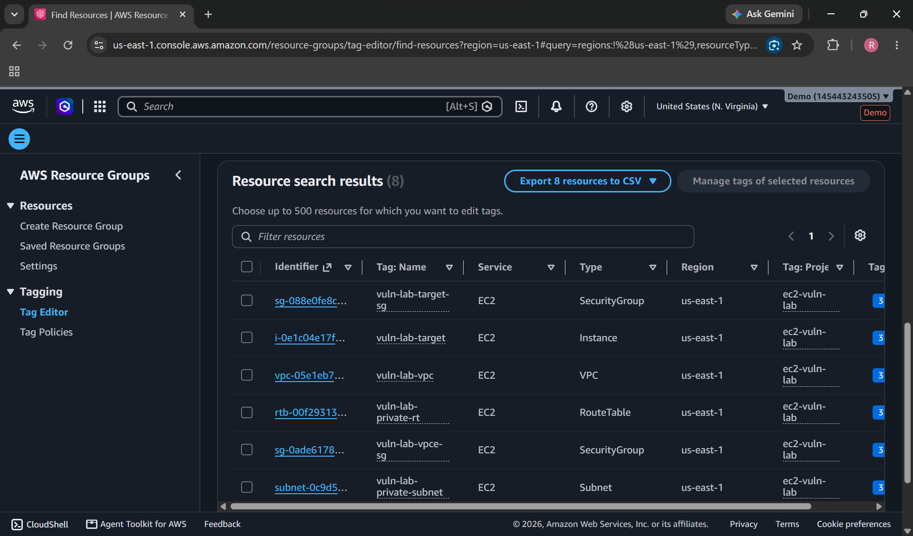
*04: Lab resources, tagged by project.*

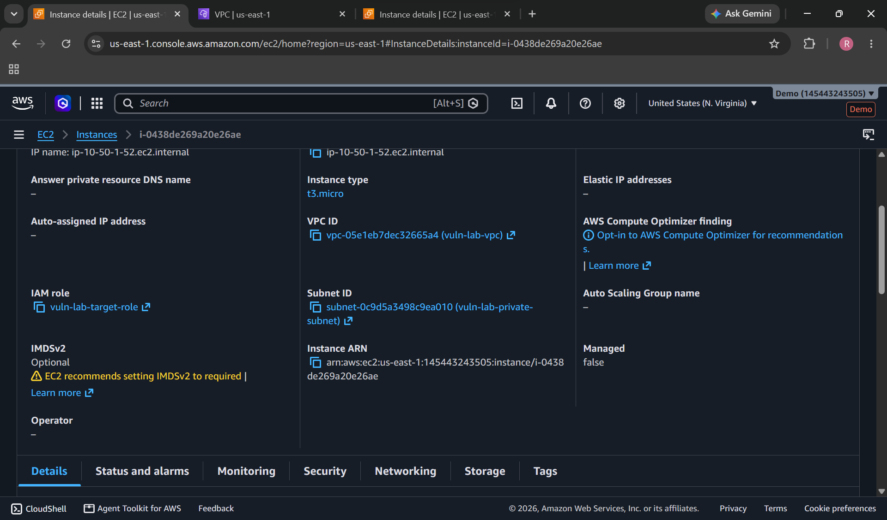
*05: IMDSv1 allowed before remediation (CLD-01).*

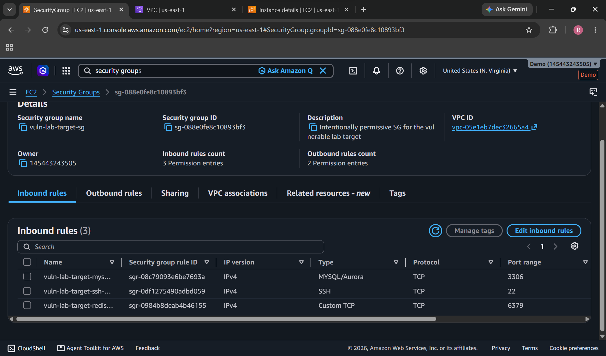
*06: SSH, MySQL, and Redis open to 0.0.0.0/0 (CLD-02 to CLD-04).*

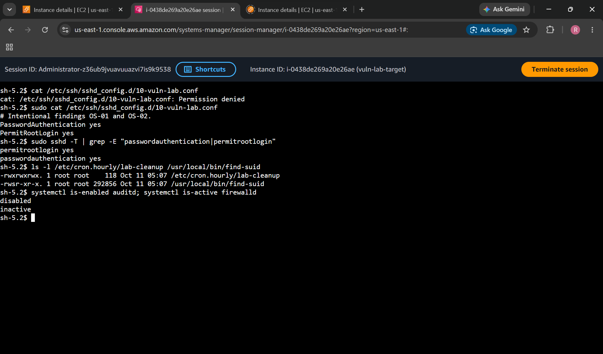
*07: Weak OS settings seen through Session Manager: password login, root login, SUID binary, 0777 cron script, auditd and firewalld off.*

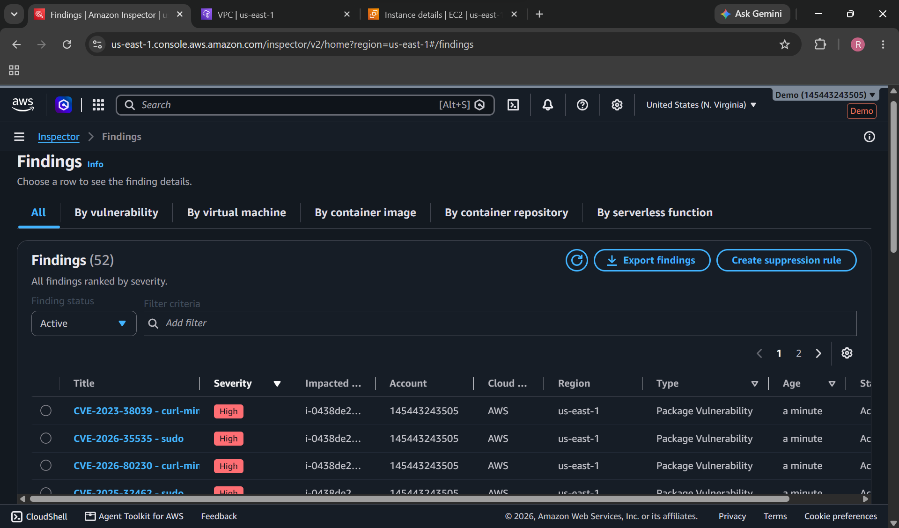
*09: Amazon Inspector findings, including CVEs on pinned packages.*

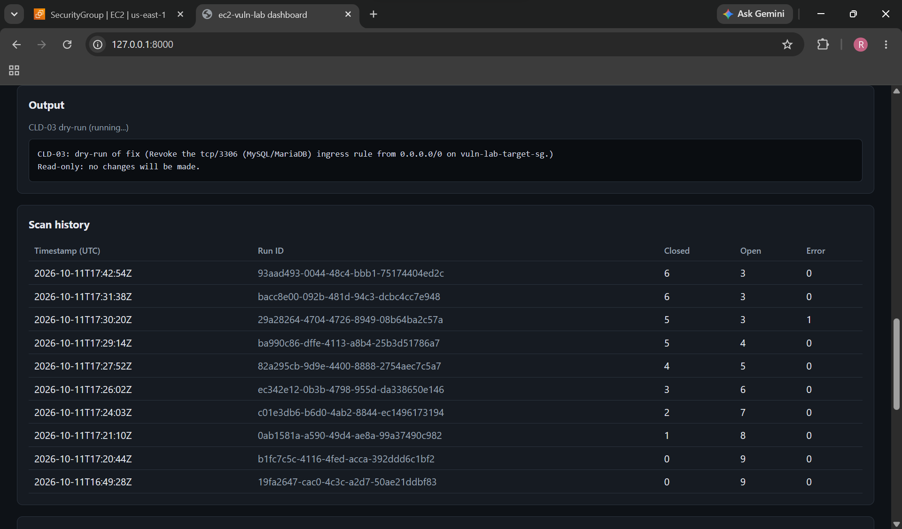
*11: Dashboard dry-run with live output before any change.*

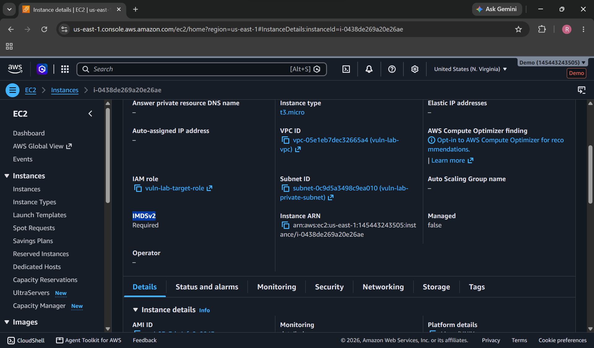
*12: IMDSv2 required after remediation.*

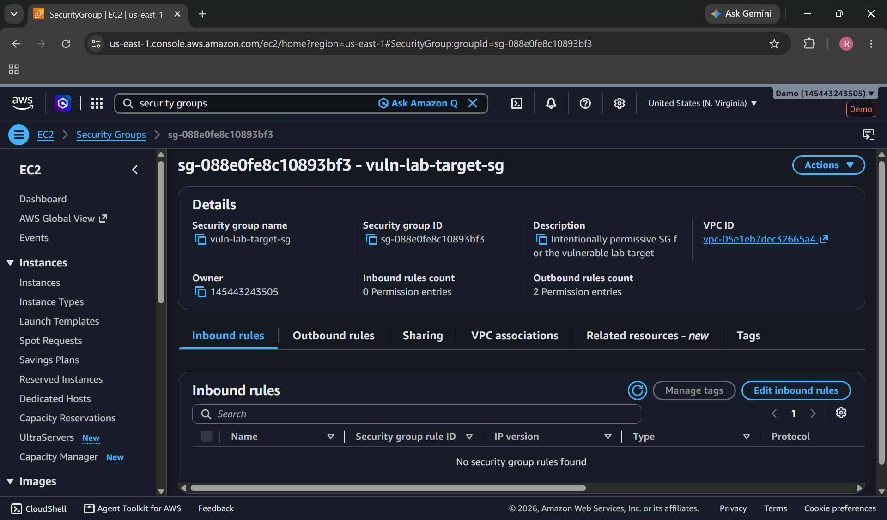
*13: Security group with no world-open rules.*

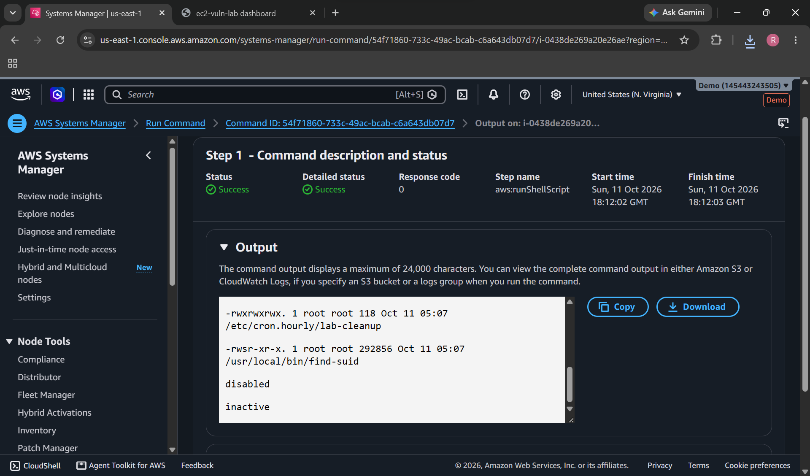
*14: Read-only Systems Manager Run Command checking OS settings after remediation.*

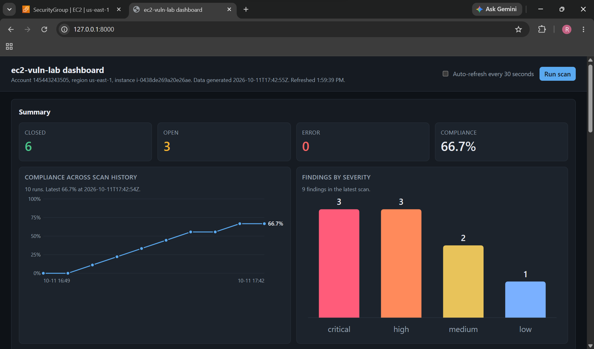
*15: Dashboard after remediation: 6 closed, 3 open, 66.7% compliance.*

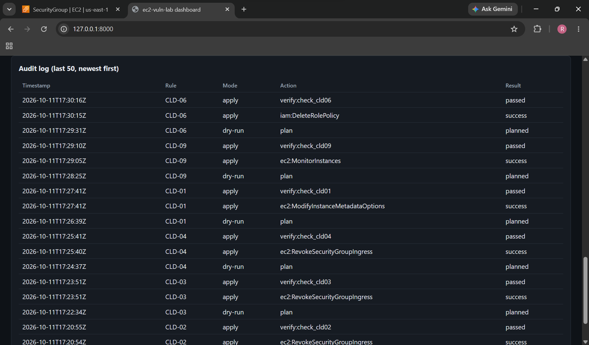
*16: Audit log with dry-run, apply, and verify entries per rule.*

Screenshot 10 (Security Hub) is pending: the AWS Foundational Security Best Practices standard has to finish evaluating the instance.

## Reproduce

This deploys intentionally vulnerable infrastructure. Use a dedicated sandbox account only.

1. Apply `terraform/01-guardrails-mgmt` with the management account profile (for example `mgmt`).
2. Apply `terraform/02-guardrails-sandbox` with the sandbox account profile (for example `sandbox`).
3. Apply `terraform/03-vuln-instance` (default profile `sandbox-tf`).
4. Run the scanner: `python scanner/cloud_checks.py --profile sandbox-tf`
5. Dry-run a rule: `python remediations/engine.py --dry-run CLD-01`. Review it, set `approved_by` and `approved_on` in the rule file, then apply it: `python remediations/engine.py --apply CLD-01`
6. Start the dashboard: `py -3.13 webapp\server.py`, then open http://127.0.0.1:8000/

To reset the lab to its vulnerable state, run `terraform plan` and then `terraform apply` in `terraform/03-vuln-instance`.
