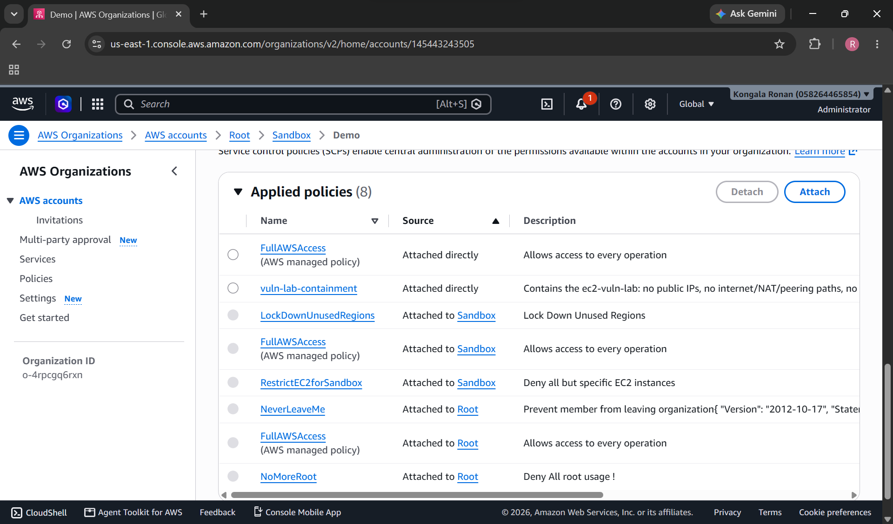
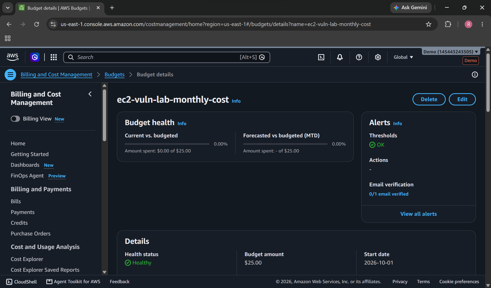
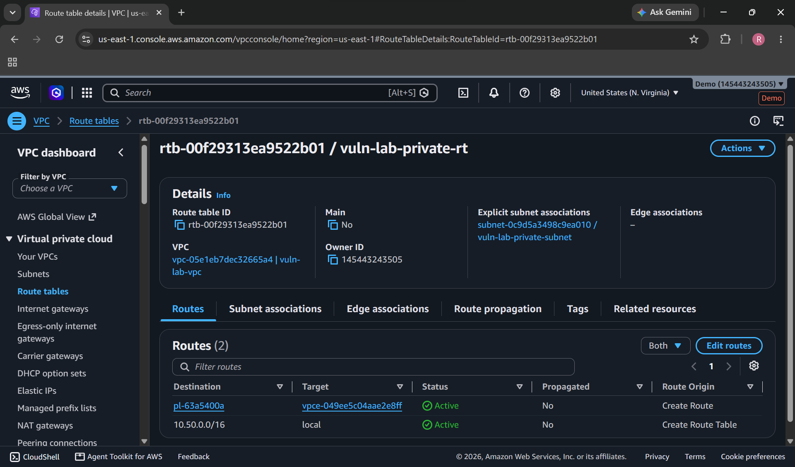

# ec2-vuln-lab

## Pipeline

The lab builds an intentionally vulnerable EC2 target, detects its weaknesses, remediates them through approved rules, verifies each fix independently, and records every action.

### 1. Build the target

Terraform creates a t3.micro in a private subnet with no internet route.


*Lab resources, tagged by project.*

### 2. Baseline misconfigurations

Terraform and the bootstrap script create the weaknesses.


*IMDSv1 allowed (CLD-01)*


*SSH, MySQL and Redis open to 0.0.0.0/0 (CLD-02 to CLD-04)*


*Weak OS settings: password login, root login, SUID binary, 0777 cron script, auditd and firewalld off*

### 3. Detect

The scanner checks nine cloud findings.


*Amazon Inspector findings, including CVEs on pinned packages (OS-10).*

### 4. Remediate with rules

Each finding maps to a rule file. Dry-run shows the plan with live output before any approval.


*Dashboard dry-run streaming output before any change.*

### 5. Verify the fix

Each fix is re-checked by the same scanner check.


*IMDSv2 now required*


*Security group with no open world rules*

### 6. Confirm on the host

A read-only Systems Manager Run Command checks the OS settings after remediation.


*Run Command output: OS settings checked on the instance.*

### 7. Report and audit

The dashboard shows 6 of 9 findings closed and 66.7% compliance. Every action is recorded in the audit log.


*Dashboard after remediation: 6 closed, 3 open*


*Audit log: dry-run, apply and verify entries per rule*

### Guardrails

Before the target is built, Terraform sets up an SCP that blocks public IPs, internet gateways and public snapshots, a budget alarm, and a private VPC.

| SCP | Budget alarm | Route table with no internet route |
| --- | --- | --- |
|  |  |  |

## Resetting the lab

The Terraform stack in terraform/03-vuln-instance builds the vulnerable target from scratch. It is the reset path: running terraform apply there rebuilds the intentionally vulnerable state, undoing the remediations applied by the engine.

Remediation changes (security group revokes, metadata option, monitoring, and the IAM policy removal) are made outside Terraform state, so a Terraform apply overwrites them. A `terraform apply` in this stack undoes every remediation: it recreates the open security group rules, the IAM policy, and the metadata and monitoring settings, and it replaces the instance. The audit log in results/remediation-log.jsonl records every change made, and the scanner output in results/ shows the current state. Run `terraform plan` first to see exactly what it will change.

## Dashboard

A local web dashboard shows the scan results and runs the remediation engine's commands from a browser.

To start it, run this from the project root in PowerShell:

```powershell
py -3.13 -m pip install -r webapp\requirements.txt
py -3.13 webapp\server.py
```

Then open http://127.0.0.1:8000/. The server listens on 127.0.0.1 only, so it is not reachable from other machines. It has no login, so do not expose it to a network.

What it shows:

- Summary cards (closed, open, error, compliance percent), a compliance trend across scan history, and findings by severity.
- A findings table with filters for status, severity, fix type, and a text search on ID and title.
- Clicking a row shows the rule description, rollback, allowed actions, evidence, and the finding's status across history runs.
- Scan history and the audit log, read from results\.

What the buttons do:

- Run scan runs the cloud scanner and rebuilds the dashboard data. Read-only.
- Dry-run shows what a rule would change, using read-only calls only. Always safe.
- Apply runs a rule's fix, then verifies it. Enabled only for automated rules that have an approved_by value set. Apply asks for confirmation and shows the dry-run plan first.
- Rollback reverses an applied rule. Same rules as Apply.

Manual rules (CLD-05, CLD-07, CLD-08) have no button. They need a rebuild or a design change, so the dashboard shows them as open.

Secrets: the dashboard and the server never display secret values. Lines containing password, secret, or token are removed from command output, and the user-data finding shows only the key name.

## Rule approval

Every rule file in remediations\rules has an approved_by field, and a new rule starts with approved_by: pending. The engine refuses to apply a pending rule. A rule is approved by a person who reads it and then sets approved_by and approved_on in its file. Dry-run still works on pending rules, so you can review a plan before approving it.

## Screenshots

The screenshots in screenshots\ show the lab in three states.

- Baseline, before any fix: 01 to 07 and 09. These show the SCP, budget, VPC route table, tagged resources, IMDSv1 setting, open security group rules, Session Manager OS settings, and the Inspector findings.
- Remediation: 11 to 13. These show the dashboard running a dry-run with live output, IMDSv2 set to Required, and the security group with its open rules removed.
- Results: 14 to 16. Screenshot 14 is a read-only Systems Manager Run Command that checks the OS settings after remediation. Screenshot 15 is the dashboard summary with 6 closed and 3 open. Screenshot 16 is the audit log.
- Screenshot 10 (Security Hub) is pending: the AWS Foundational Security Best Practices standard needs to finish evaluating the instance.

